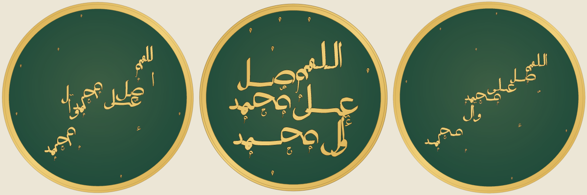
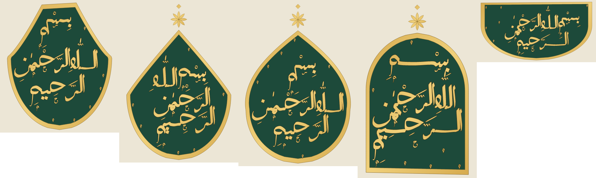
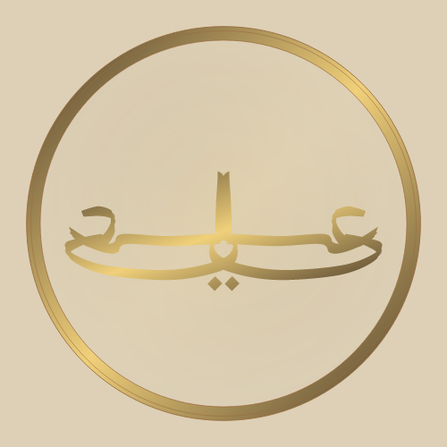
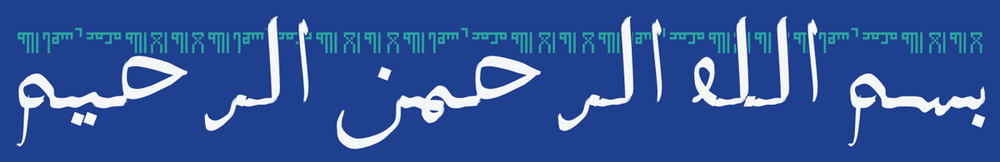

# Composing thuluth istif by computer: reading paths and a critic learned from one person's eye

_Draft for sideprojects.blog (PLAN-2 §10). Numbers are from the repository as of 24 October 2026; replace the images
with the rebuilt showpieces before publishing._

## The problem

Istif is the art of stacking a phrase in thuluth so that it fills a shape: words climb over one another, stems interlace
and tails cradle whole words, and yet the phrase still reads in order. A literature sweep in English, Turkish, Arabic
and Persian found no prior work that composes istif computationally, or that turns the classical rules (M. Uğur
Derman's account in the TDV İslâm Ansiklopedisi) into something a computer can score.

This project draws thuluth with a pen model rather than a font: each letter is a skeleton drawn with a broad nib held at
a fixed angle, so thick and thin come from the angle alone. Letters are learned from the Calliar dataset of online
handwritten calligraphy and fitted to masters' work. On top of that sits a composer that arranges words by simulated
annealing.

## Reading paths with fitted lanes

Left to itself, the annealer scatters words. A six-word salawat defeated every earlier approach: words drifted, or ran
in one long line, or leaned on a diagonal. The fix was to give the composition a spine. A **reading path** is one or
more strokes in reading order, with pen lifts between them. Each word gets a target point along it in proportion to its
width, and the composer keeps each word near its target while letters still stack, dip and interlock around it.

The best path turned out to be the plainest: **fitted horizontal lanes**, chords of the field read from the top down,
their number and spacing chosen so each band is about a word high and the lanes together span the field. Two reading
rules keep the order: a later word level with an earlier one starts to its left, and no word climbs back above the one
before. Both are judged from each word's first letter, not its box, because a tall alif makes boxes overlap.

Parallel diagonal lanes failed: words on neighbouring lanes sat side by side at the same height and read as pairs.
Routes traced from 64 Calliar compositions are available too, made to read downward.

## A critic learned from pairwise ratings

Taste is the hard part. The project's owner rated pairs of compositions ("which is more beautiful?") on a page that
keeps every vote in a durable store. A critic reads only an image (ink and field masks), so it can judge the engine's
output and a master's photograph alike. Its features follow Derman: evenness of texture, heavy knots, looseness at the
top rather than the bottom, unity (one body rather than scattered parts), span and fill.

Fitted to 148 votes over 81 compositions by logistic regression on differences of standardised features, it predicts
held-out choices 67% of the time overall, 69% for dense phrases and 88% for mirrored work (fewer votes). Unity mattered
most; "looseness at the top" barely mattered to this rater, which is why every new check is kept as a reported number
until the ratings show it predicts choices. The rating page now picks the pairs the critic is least sure about, so each
vote teaches more.

## Noise

The rater's word for what spoiled a composition was "noise": unresolved contact, strokes that nearly touch. It is
measured as notches (pixels a small morphological closing fills) and pinholes (tiny enclosed holes), standardised
against the rated set and summed. Measures of fragments, edge length and fine detail failed: they cannot tell intended
richness from noise. Thin slivers failed too: they track thin strokes, which the rater rewards.

## Rules from the classical sources, made computable

- **Marks** (the Egyptian Cultural Development Fund's notes on tashkil): a fatha as long as its space allows, in three
  lengths measured in dots of the main pen; all fathas parallel; vowels with a third of the pen; small clarifying
  letters under ح س ص ط ع ك م; the dagger alif of الله seated on its shadda. The same composition ranked 9th with these
  marks and 26th without.
- **Crossings** (girift): a stem through a horizontal is sought; a crossing at a curve or through a letter's eye is a
  fault. With every sample of ink knowing which letter drew it, crossings are counted exactly.
- **Shaped fields**: Derman's pear, drop, tulip, mihrab arch and ship's hull, with lanes as the shape's chords and a
  finial at a pointed tip.

## Mirrored composition, combined

In a müsennâ the halves are one design: what falls on the axis is shared, not doubled. A tall stroke on the axis
becomes one shared stem; a dot group that overlaps its mirror image becomes one symmetric group; a slanted vowel on the
axis is left out. The combined علي ranked 2nd of 81; the same design drawn apart ranked 29th. Mirroring is offered only
where a tall stroke can be shared: the mirrored محمد, where the halves only face each other, read as a horned mask.

## Kufic with thuluth

The Timurid band sets a Kufic line in the upper zone of a jali thuluth band, the uprights passing over it with a
hairline.

## Towards a paper

Candidate venues: Bridges (mathematics and art), the Nexus Network Journal, Eurographics' expressive track.
Contributions:

1. reading paths with fitted lanes, and reading order judged from first letters;
2. a critic learned from pairwise ratings, fitted per genre;
3. the noise measure;
4. rules from classical treatises made computable (marks, crossings, fields);
5. combined mirrored composition.

Still to do before publishing: rebuild the showpieces on the finished engine, gather a second round of ratings (the
rating page is live) and report the critic's accuracy on it, and compare against masters' istif with the same critic.
